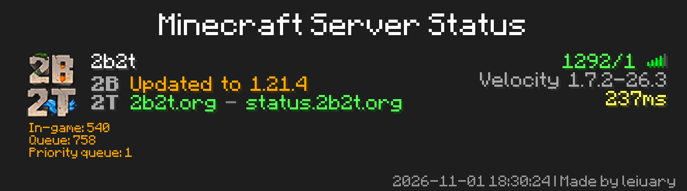

<div align="center">
    <a href="https://v2.nonebot.dev/store">
    </a>

## ✨ nonebot-plugin-mcserver-status-check ✨
[](./LICENSE)
[](https://pypi.python.org/pypi/nonebot-plugin-mcserver-status-check)
[](https://www.python.org)

</div>

## 📖 介绍

- 支持同时查询多个服务器。
- 生成 Minecraft 多人游戏服务器列表样式图片。
- 显示服务器图标 (Favicon)。
- 解析并渲染 Minecraft 颜色代码 (MOTD)。
- 详细的延迟测试（预热、多次测试取平均值、去极值）。

### 🎨 效果图

<div align="center">
  
</div>

## 💿 安装

<details open>
<summary>使用 nb-cli 安装</summary>
在 nonebot2 项目的根目录下打开命令行, 输入以下指令即可安装

    nb plugin install nonebot-plugin-mcserver-status-check --upgrade
使用 **pypi** 源安装

    nb plugin install nonebot-plugin-mcserver-status-check --upgrade -i "https://pypi.org/simple"
使用**清华源**安装

    nb plugin install nonebot-plugin-mcserver-status-check --upgrade -i "https://pypi.tuna.tsinghua.edu.cn/simple"


</details>

<details>
<summary>使用包管理器安装</summary>
在 nonebot2 项目的插件目录下, 打开命令行, 根据你使用的包管理器, 输入相应的安装命令

<details open>
<summary>uv</summary>

    uv add nonebot-plugin-mcserver-status-check
安装仓库 master 分支

    uv add git+https://github.com/leiuary/nonebot-plugin-mcserver-status-check@master
</details>

<details>
<summary>pdm</summary>

    pdm add nonebot-plugin-mcserver-status-check
安装仓库 master 分支

    pdm add git+https://github.com/leiuary/nonebot-plugin-mcserver-status-check@master
</details>
<details>
<summary>poetry</summary>

    poetry add nonebot-plugin-mcserver-status-check
安装仓库 master 分支

    poetry add git+https://github.com/leiuary/nonebot-plugin-mcserver-status-check@master
</details>

打开 nonebot2 项目根目录下的 `pyproject.toml` 文件, 在 `[tool.nonebot]` 部分追加写入

    plugins = ["nonebot_plugin_mcserver_status_check"]

</details>

<details>
<summary>使用 nbr 安装(使用 uv 管理依赖可用)</summary>

[nbr](https://github.com/fllesser/nbr) 是一个基于 uv 的 nb-cli，可以方便地管理 nonebot2

    nbr plugin install nonebot-plugin-mcserver-status-check
使用 **pypi** 源安装

    nbr plugin install nonebot-plugin-mcserver-status-check -i "https://pypi.org/simple"
使用**清华源**安装

    nbr plugin install nonebot-plugin-mcserver-status-check -i "https://pypi.tuna.tsinghua.edu.cn/simple"

</details>


## ⚙️ 配置

在 nonebot2 项目的`.env`文件中添加下表中的配置

```dotenv
# 服务器列表
MSC_SERVER_LIST='[]'

# 同一服务器并发探测请求的启动间隔(秒)
MSC_LATENCY_INTERVAL=0.2

# 延迟测试预热次数
MSC_LATENCY_WARMUP=2

# 延迟测试次数
MSC_LATENCY_COUNT=3

# 是否去极值
# true: 去掉最大最小，取平均 (默认，次数自动加二)
# false: 不去极值，直接取平均
# "best": 最低延迟优先 (适用于校园网等多运营商宽带聚合环境，此时建议调高测试次数)
MSC_LATENCY_TRIM=true

# 是否在控制台显示详细信息
MSC_SHOW_TIMING_DETAILS=false

# 触发指令列表
MSC_COMMAND_TRIGGERS=["查服"]

# 汇总图片是否显示服务器响应附带的玩家样例（不是完整名单；单服查询不受此项影响）
MSC_SHOW_PLAYER_LIST=false

# 自定义背景图片目录；每次随机选图。留空则随机选择内置 Minecraft 全景背景版本与水平视角，左下角标注背景版本范围
# 常见格式：PNG、JPEG、WebP、BMP、GIF（首帧）、TIFF、ICO；尺寸比例不同会居中裁切，不拉伸
# 示例：./data/minecraft-backgrounds
MSC_BACKGROUND_PATH=

# 是否启用 Minecraft 菜单背景模糊；默认开启（影响内置和自定义背景）
MSC_BACKGROUND_BLUR=true
```

### 服务器列表配置示例

```dotenv
MSC_SERVER_LIST='[
  {"address": "mc.hypixel.net", "alias": "Hypixel"},
  {"address": "play.example.com"}
]'
```

## 🎉 使用
### 指令列表

- **查服**
  - 查询所有配置的服务器状态，生成汇总图片。
- **查服 [IP/别名]**
  - 单独查询指定服务器的状态。
- **查服列表**
  - 查看当前配置的服务器列表及别名。

## 💡 特性

- 🎨 **原版风格**：按 Minecraft 多人游戏服务器列表布局绘制。
- ⚡ **高效并发**：支持多服务器并行查询，速度飞快。
- 📊 **精准延迟**：内置预热和去极值算法，提供最真实的延迟数据。
- 📝 **颜色支持**：完整支持 Minecraft 样式代码 (§) 和 JSON 格式 MOTD。
- 🖼️ **图标显示**：自动获取并显示服务器 Favicon。
- 👥 **玩家样例**：显示服务器状态响应提供的内容；服务器可能省略或自定义，未必是玩家名称。

## 📝 TODO
- [ ] 支持不同群聊存放不同列表。
- [ ] 支持基岩版服务器查询.
